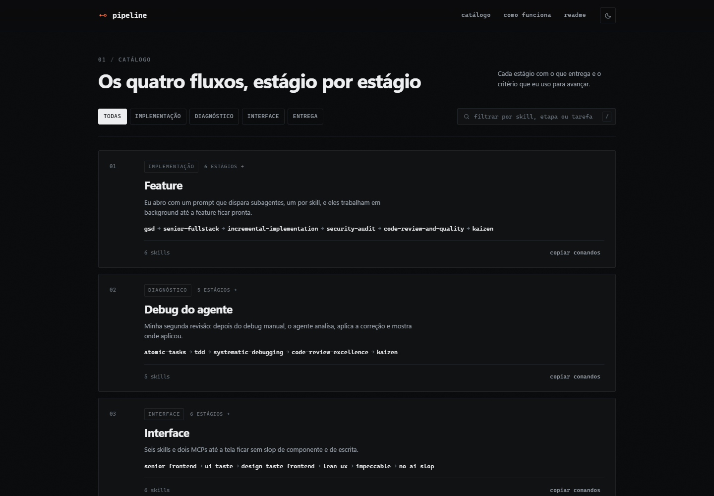

<picture>
  <source media="(prefers-color-scheme: dark)" srcset="assets/readme/logo-dark.svg">
  
</picture>

Quatro pipelines de skills que eu uso no trabalho e nos meus projetos pessoais: feature, debug do agente, interface e entrega. Nenhum está aqui como exemplo. Em cada um, todo estágio tem uma entrega e um critério de saída.



---

## Por que escrever a ordem

Skill isolada não diz quando parar. `/tdd` não sabe que veio depois de uma investigação quebrada em tarefas, e `/code-review-excellence` não sabe que o código ainda falha em algum caminho.

O que eu ganho anotando a sequência:

1. Não decido do zero quais skills usar em cada tarefa parecida.
2. Consigo parar no meio e retomar, porque o plano está escrito.
3. Quando algo passa batido, eu sei em qual estágio deveria ter sido pego.

---

## Como abrir

Não há build nem dependência. O arquivo abre sozinho.

```bash
# opção 1: duplo clique
index.html

# opção 2: servidor estático, se preferir
python -m http.server 8080
```

Funciona em `file://` porque os dados são um script clássico, não um `fetch` de JSON.

---

## Os quatro pipelines

### 1. Feature · `Implementação`

Eu abro com um prompt que dispara subagentes, um por skill, e eles trabalham em background até a feature ficar pronta.

```
/gsd → /senior-fullstack → /incremental-implementation
     → /security-audit → /code-review-and-quality → /kaizen
```

| # | Papel | Skill | Entrega | Gate |
|---|---|---|---|---|
| 1 | Enquadrar | `gsd` | `PLAN` da fase com tarefas e critério | cada tarefa tem verificação objetiva |
| 2 | Definir a forma | `senior-fullstack` | stack decidida, scaffold, relatório P0 | nenhum P0 antes da primeira fatia |
| 3 | Construir em fatias | `incremental-implementation` | commits pequenos, app de pé | testes e build verdes a cada fatia |
| 4 | Auditar a segurança | `security-audit` | findings com severidade e correção mínima | nenhum alto ou crítico sem correção |
| 5 | Revisar em cinco eixos | `code-review-and-quality` | review classificado | zero bloqueantes |
| 6 | Fixar o padrão | `kaizen` | uma melhoria permanente no repo | a próxima feature herda o padrão |

**No fim eu recebo:** uma equipe de subagentes trabalhando em background e uma feature precisa, correta, com a segurança validada.

---

### 2. Debug do agente · `Diagnóstico`

Minha segunda revisão, depois do debug manual.

```
/atomic-tasks → /tdd → /systematic-debugging
              → /code-review-excellence → /kaizen
```

| # | Papel | Skill | Entrega | Gate |
|---|---|---|---|---|
| 1 | Quebrar em tarefas | `atomic-tasks` | tarefas atômicas, cada uma em contexto novo | cada tarefa cabe em uma sessão |
| 2 | Travar o comportamento | `tdd` | teste vermelho antes da correção | falha no código atual, passa com o fix |
| 3 | Achar a causa raiz | `systematic-debugging` | causa raiz + evidência | nenhuma falha sem causa nomeada |
| 4 | Revisar a correção | `code-review-excellence` | review com severidade e diff anotado | zero bloqueantes |
| 5 | Não repetir | `kaizen` | barreira no repositório | o bug não volta sem aviso |

**No fim eu recebo:** uma análise, a correção já aplicada e o ponto exato onde ela entrou, para eu revisar de novo.

---

### 3. Interface · `Interface`

Seis skills e dois MCPs, da base do projeto até a revisão do texto na tela.

```
/senior-frontend → /ui-taste → /design-taste-frontend
                 → /lean-ux → /impeccable → /no-ai-slop
```

MCPs: `shadcn`, `magicui`.

| # | Papel | Skill | Entrega | Gate |
|---|---|---|---|---|
| 1 | Montar a base | `senior-frontend` | projeto e componentes com padrão de performance e a11y | build limpo, componente renderizando |
| 2 | Escolher a direção | `ui-taste` | layout, hierarquia e escala de tipo | hierarquia clara na tela |
| 3 | Compor as seções | `design-taste-frontend` | direção sorteada e blueprint por seção | zero falhas no inspetor |
| 4 | Checar pelo uso | `lean-ux` | hipótese e experimento mais barato | a hipótese pode ser invalidada por teste |
| 5 | Passar o acabamento | `impeccable` | correções de espaçamento, estado e foco | funciona no tamanho real, inclusive teclado |
| 6 | Limpar a escrita | `no-ai-slop` | copy com termo concreto | nenhuma frase serve em outro produto |

**No fim eu recebo:** uma interface livre de slop de componente e de texto, responsiva e alinhada com o que eu queria.

---

### 4. Entrega · `Entrega`

Do commit solto ao PR.

```
/atomic-commits → /code-review → /create-pr
```

| # | Papel | Skill | Entrega | Gate |
|---|---|---|---|---|
| 1 | Organizar o histórico | `atomic-commits` | um commit por mudança lógica | cada commit passa sozinho |
| 2 | Revisar o diff | `code-review` | achados de padrão e de spec, separados | nada da spec em falta, nenhum desvio sem justificativa |
| 3 | Abrir o PR | `create-pr` | PR com contexto e evidência de teste | explica o que mudou, por que e como foi verificado |

**No fim eu recebo:** commits atômicos, diff revisado e PR aberto com a descrição que o revisor precisa.

---

## Skill e pipeline

| | Skill | Pipeline |
|---|---|---|
| **O que é** | uma competência isolada | uma sequência com dependências |
| **Responde** | o que sabe fazer | em que ordem, e quando parar |
| **Alcance** | qualquer contexto | um tipo de tarefa |
| **Saída** | o resultado da execução | um artefato por estágio |
| **Fim** | quando a resposta sai | quando o critério do estágio é cumprido |

---

## O que eu não terceirizo

Agente escreve, revisa e testa. A decisão continua sendo minha.

Eu debugo na mão antes de pedir a segunda revisão. Leio o diff antes de aprovar. Confiro o que o teste cobre. Debug, revisão de código e qualidade não podem morrer: são processos que eu pratico em toda tarefa, com agente ou sem.

Isso explica a ordem de dois fluxos. O debug do agente só começa depois do debug manual, e o `kaizen` fecha os dois para o mesmo erro não voltar do mesmo jeito.

---

## Memória do agente

Sessão que começa do zero repete o erro de ontem. Duas ferramentas guardam o que já foi decidido e corrigido:

- **Obsidian**: meu vault de notas, aberto ao agente por MCP (pacote `@bitbonsai/mcpvault`). O agente lê e escreve nas notas do projeto.
- **AI-Memory**: servidor MCP local que registra sessões, observações e decisões em páginas consultáveis.

Antes de refazer uma investigação, eu busco ali. As duas ficam fora dos pipelines: o trabalho consulta essa memória antes de começar.

---

## Três regras que os quatro seguem

**1. Cada estágio deixa algo pronto para o próximo.**
Se o estágio não produz nada que o próximo usa, ele não está no pipeline. Sem entrega, não há como verificar.

**2. Só avanço quando o critério é cumprido.**
Concluir a tarefa não quer dizer que o objetivo foi alcançado. Quem decide se o estágio fechou é o critério dele, não o tempo que passou.

**3. A ordem muda o resultado.**
`systematic-debugging` vem antes de `code-review-excellence` porque revisar código que ainda falha gasta tempo com o problema errado. `tdd` vem antes de `systematic-debugging` para o bug virar teste antes de virar correção.

**Limite prático:** pipeline longo consome contexto. Quando o agente começa a esquecer o plano, eu paro e retomo do estágio em que estava, com o `PLAN` e as decisões registrados. Reiniciar do zero custa mais do que retomar.

---

## De onde vêm as skills

As skills vêm de repositórios públicos. Li a origem de cada uma no `.skill-lock.json` da minha instalação, e cada linha abaixo leva ao repositório do autor.

| Criador | Skills | Repositório |
|---|---|---|
| addyosmani | incremental-implementation, code-review-and-quality | [agent-skills](https://github.com/addyosmani/agent-skills) |
| alirezarezvani | senior-fullstack, senior-frontend | [claude-skills](https://github.com/alirezarezvani/claude-skills) |
| mattpocock | tdd, code-review | [skills](https://github.com/mattpocock/skills) |
| cloudflare | security-audit | [security-audit-skill](https://github.com/cloudflare/security-audit-skill) |
| ctsstc | gsd | [get-shit-done-skills](https://github.com/ctsstc/get-shit-done-skills) |
| neolabhq | kaizen | [context-engineering-kit](https://github.com/neolabhq/context-engineering-kit) |
| thebeardedbearsas | atomic-tasks | [claude-craft](https://github.com/thebeardedbearsas/claude-craft) |
| wshobson | code-review-excellence | [agents](https://github.com/wshobson/agents) |
| Uizze | ui-taste | [uizze.sh](https://uizze.sh) |
| Leonxlnx | design-taste-frontend | [taste-skill](https://github.com/Leonxlnx/taste-skill) |
| wondelai | lean-ux | [skills](https://github.com/wondelai/skills) |
| pbakaus | impeccable | [impeccable](https://github.com/pbakaus/impeccable) |
| petergyang | no-ai-slop | [no-ai-slop](https://github.com/petergyang/no-ai-slop) |
| nullswan | atomic-commits | [atomic-commits](https://github.com/nullswan/atomic-commits) |
| warpdotdev | create-pr | [common-skills](https://github.com/warpdotdev/common-skills) |
| superpowers | systematic-debugging | sem repositório no lock local |

Para instalar, o catálogo fica em [skills.sh](https://www.skills.sh/).

`systematic-debugging` cita a coleção `superpowers` no próprio texto e não registra repositório no `.skill-lock.json`. Preferi deixar sem link a apontar para um repositório que não consegui confirmar.

---

## Estrutura

```
Pipeline/
├── index.html            # shell da página e conteúdo estático
├── assets/
│   ├── css/style.css     # sistema visual (escuro/claro, responsivo)
│   ├── js/
│   │   ├── data.js       # o catálogo. edite aqui.
│   │   └── app.js        # router, filtros, cópia, tema
│   └── readme/           # logo e screenshot usados aqui
└── README.md
```

---

## Atalhos

| Tecla | Ação |
|---|---|
| `/` | foca a busca |
| `Esc` | limpa os filtros |
| clique na skill do estágio | copia o comando daquele estágio |

---

## Licença

[MIT](LICENSE). Se você adaptar o catálogo para o seu conjunto de skills, o formato foi feito para isso.
